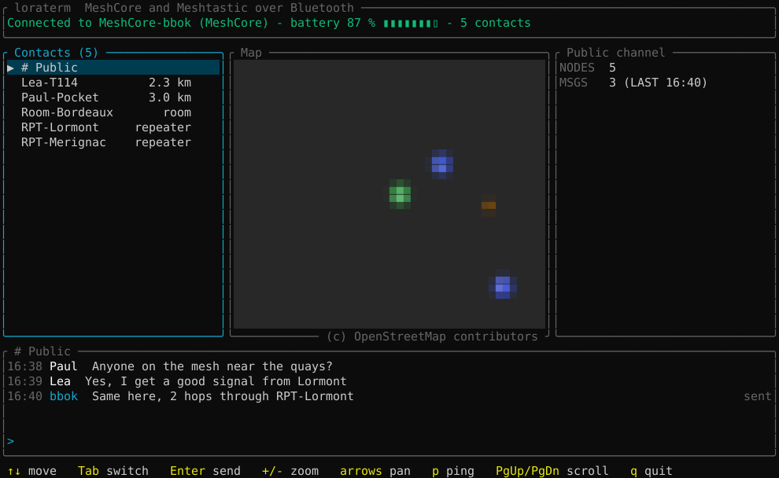
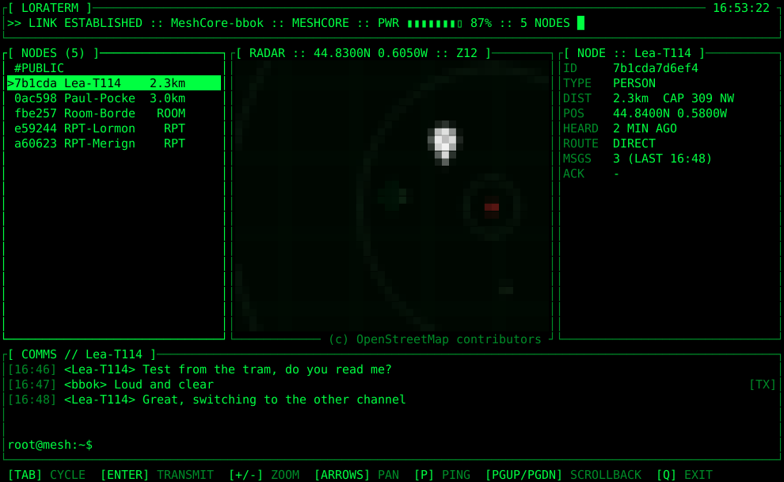

# loraterm

A terminal client for a MeshCore or Meshtastic radio over Bluetooth. You
can send and receive messages, direct or on the public channel, and see the
nodes on a map. The program finds out which firmware the radio runs.

Tested on Linux (BlueZ) with an ELECROW ThinkNode M5 running either the
MeshCore Companion Bluetooth v1.18.0 firmware from
https://meshcore.io/flasher or Meshtastic 2.7.26.

The two looks, Normal and Hacker (sample data, the map tiles are not shown):

<p>
  
  
</p>

## Build

You need Rust.

```
cargo build --release
```

The program is `target/release/loraterm`.

## Pair the radio

Pair once from `bluetoothctl`, under either firmware. The radio wants a
bond made with its PIN; pairing from the KDE Bluetooth settings leaves a
bond the radio drops a few seconds after each connection.

```
bluetoothctl
agent KeyboardOnly
default-agent
scan on
pair AA:BB:CC:DD:EE:FF
```

Put your radio's address in the last line, then type the PIN shown on the
radio's screen (the M5 picks a new one at each boot). Or let
`scripts/pair-radio.py` do it all: it finds the radio, removes an old
pairing and asks for the PIN when bluetoothctl needs it. After switching the
radio to the other firmware, run `remove` with its address first and pair
again: the old bond no longer works. To check the link:

```
loraterm --probe
```

## Run

```
loraterm
```

A menu asks for the look, Normal or Hacker. The program then connects to
the first radio it finds, MeshCore (named "MeshCore-...") or Meshtastic
(found by its Bluetooth service), and reconnects on its own. The header
names the firmware.

With Meshtastic:

- channel 0 is the public channel; direct messages get a receipt when the
  destination acknowledges them;
- nodes come from the radio's node database, without a contact list;
- `p` traces the route to any node (traceroute) instead of asking a
  repeater for its status;
- the program sets the radio's clock at each connection;
- the conversations of the two firmwares are kept apart in the history.

Options:

- `--device <name or address>`: the radio to use
- `--probe`: print the radio's state and exit
- `--image auto|sixel|kitty|iterm2|halfblocks`: how the map image is shown
- `--console`: ASCII look with a radar of letters instead of the map;
  automatic on the Linux console (`TERM=linux`)

The map looks best in a terminal that shows images with the Kitty, Sixel
or iTerm2 protocol, like Konsole. Other terminals get a coarser picture
made of half blocks.

## Keys

- Tab: go from the contact list to the map, then to the input line
- Arrows: pick a contact in the list, pan the map
- `+` and `-`: zoom the map
- Enter: send the message you typed
- PgUp and PgDn: scroll the conversation
- `p`: ping the selected node (MeshCore repeater or room), or trace the
  route to it (Meshtastic)
- `q` or Ctrl+C: quit

Outside the input line only, `p` pings and `q` quits.

## Files

- Messages: `~/.local/share/loraterm/history.jsonl`
- Map tiles: `~/.cache/loraterm/tiles/`
- Log: `$XDG_RUNTIME_DIR/loraterm.log`

The project was called meshcore-m5. On its first start, loraterm moves the
old `~/.local/share/meshcore-m5` and `~/.cache/meshcore-m5` folders to the
new names, unless the new ones already exist.

The plan is in [ROADMAP.md](ROADMAP.md).

## License

GPL-3.0, see [LICENSE](LICENSE).

- Map tiles: (c) OpenStreetMap contributors.
- Node icons: map.meshcore.io by Rastislav Vysoky, MIT, see
  `assets/node_types/LICENSE`.
- `vendor/meshcore-rs`: meshcore-rs 0.2.0 (MIT) with our Bluetooth fixes.
